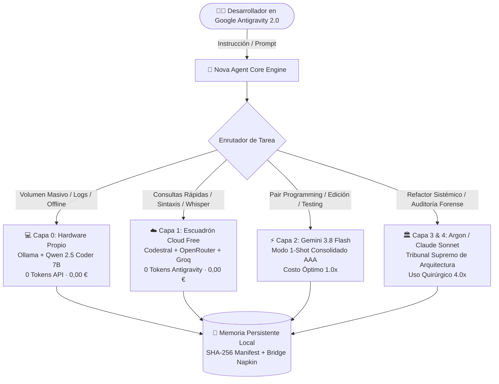

# 🌌 NOVA AGENT: The Google-Native Autonomous Engineering Engine
### Agente Autónomo de Ingeniería de Software, Copiloto Técnico Senior & Motor de Eficiencia de Tokens para Google Antigravity 2.0

[](LICENSE)
[](#-instalación-en-1-clic-auto-instalador-de-antigravity-incluido)
[](https://antigravity.google)
[](#-la-ideología-100-ecosistema-google)
[](#-catálogo-detallado-de-skills-por-especialidad)
[](#-capa-de-integridad-criptográfica-y-anti-plagio)
[](#-la-pirámide-de-escalado-de-4-capas)

**Nova Agent** no es un prompt leak ni una extensión visual de editor: es un **Agente Autónomo de Ingeniería de Software de Código Abierto**, dotado de cerebro agéntico, memoria persistente local, disciplina de trinchera y un árbol de 125 habilidades especializadas diseñado y acoplado nativamente para **Google Antigravity 2.0** y los modelos **Google Gemini**.

Diseñado, entrenado y probado a fuego durante más de un mes de pruebas de estrés continuas por **Saúl Alexander Martínez Rivas** ([@Luaz2021](https://github.com/Luaz2021)), Nova Agent erradica los tres vicios crónicos de los asistentes de IA convencionales:
1. **Cero servilismo ni relleno conversacional:** Respuestas directas de arquitecta senior, código limpio bajo filosofía **KISS estricto** (*Keep It Simple, Stupid*) con *early returns*.
2. **Cero derroche de cuota de tokens:** Arquitectura optimizada para reducir el peso de arranque en un **38%**, ejecutar tareas multi-archivo en modo **`1-Shot` consolidado** y enrutar tareas ligeras hacia modelos gratuitos a 0 EUR.
3. **Cero experimentos en caliente:** Prohibido romper tu rama activa. Todo cambio o refactor se valida primero mediante pruebas unitarias aisladas (`phantom_test`) antes de tocar código de producción.

---

## 🎯 La Ideología: 100% Ecosistema Google

Mientras la inmensa mayoría de la comunidad open source compite por hacer wrappers y extensiones para Claude Code o Cursor, **Nova Agent fue concebido desde el primer día para exprimir al máximo el poder del ecosistema de Google**:

1. **Alineación con Google DeepMind:** Diseñado para correr de forma nativa en **Google Antigravity 2.0**, aprovechando su runtime por eventos, su sandbox seguro de herramientas y el CLI (`agy`).
2. **Explotación de la Ventana de Contexto de Gemini:** Las 119 skills están optimizadas para la capacidad de absorción masiva de **Google Gemini** (1M a 2M tokens), permitiendo analizar repositorios completos de golpe sin alucinaciones.
3. **Multimodalidad Nativa:** Inspección de capturas visuales de UI, análisis de vídeo técnico y procesamiento multimodal directo con Google Cloud.
4. **Costo Óptimo 1-Shot:** Pensado para operar el 90% del tiempo sobre **Gemini 3.8 Flash** a máxima velocidad y mínimo coste, escalando a **Argon** solo cuando se requiere cirugía sistémica.

---

## ⚡ Distinción Fundamental: Google Antigravity 2.0 vs. Antigravity IDE

Para entender la arquitectura de Nova Agent, es crítico separar el **runtime agéntico** de la **interfaz gráfica**:

| Concepto | Qué es realmente | Rol en el Ecosistema |
| :--- | :--- | :--- |
| **Google Antigravity 2.0** | **El Motor Agéntico y Plataforma de Ejecución de Google DeepMind.** Provee el runtime agéntico, el CLI (`agy`), el sandbox de permisos de herramientas, la invocación concurrente de subagentes, la memoria de sesión y la reactividad por eventos. | **El hábitat real de Nova Agent.** Nova vive, orquesta y ejecuta dentro de este runtime subyacente. Puede operar tanto en local como por terminal CLI (`agy`) desatendida. |
| **Antigravity IDE** | **La Interfaz Visual de Usuario (GUI / Editor gráfico).** Es la capa de visualización basada en Electron que sirve como cliente visual para interactuar con el motor. | Solo el visor. Nova Agent **no es una extensión gráfica de IDE**; el IDE es únicamente la ventana donde visualizas las acciones del agente. |

---

## 🏗️ Arquitectura del Sistema (La Pirámide de 4 Capas)

Nova Agent opera mediante una jerarquía inteligente de modelos orientada a costo óptimo y cero desperdicio de tokens:



| Capa | Motor / Proveedor | Rol Principal | Costo de Tokens |
| :--- | :--- | :--- | :--- |
| **Capa 0** | **Ollama Local (Qwen 2.5 Coder 7B)** | Tareas masivas (`>1.500` tokens repetitivos), volcados SQL, resúmenes locales de logs y desarrollo sin conexión. | **0 tokens de API (0,00 €)** |
| **Capa 1** | **OpenRouter Free + Codestral (Mistral) + Groq** | Consultas rápidas de sintaxis, transcripción Whisper de clases/audio y razonamiento ligero sin gastar cuota de Antigravity. | **0 tokens de Antigravity (0,00 €)** |
| **Capa 2** | **Gemini 3.8 Flash** | Copiloto principal en el chat de Antigravity 2.0. Ejecución `1-Shot` consolidada, edición de archivos y testing TDD. | **Factor 1.0x (Máxima velocidad)** |
| **Capa 3** | **Gemini 4 Argon / Claude Sonnet** | Cirugía mayor: rediseños sistémicos de arquitectura, incompatibilidades profundas o auditorías de seguridad militar. | **Factor 4.0x (Solo bajo demanda)** |

---

## 📑 Índice de Contenidos
1. [La Ideología: 100% Ecosistema Google](#-la-ideología-100-ecosistema-google)
2. [Google Antigravity 2.0 vs. Antigravity IDE](#-distinción-fundamental-google-antigravity-20-vs-antigravity-ide)
3. [Novedades de Ingeniería v2.1](#-novedades-de-ingeniería-v21)
4. [Instalación en 1 Clic (Windows, macOS y Linux)](#-instalación-en-1-clic-auto-instalador-de-antigravity-incluido)
5. [Router Multi-Modelo y Herramientas a 0 Tokens](#-router-multi-modelo-y-herramientas-a-0-tokens)
6. [Catálogo Detallado de Skills por Especialidad](#-catálogo-detallado-de-skills-por-especialidad)
7. [Atribuciones y Agradecimientos Open Source](#-atribuciones-y-agradecimientos-open-source-cero-cajas-negras)
8. [Capa de Integridad Criptográfica y Anti-Plagio](#-capa-de-integridad-criptográfica-y-anti-plagio)
9. [Llamada a Colaboradores: Proyecto Nova GUI](#-llamada-a-colaboradores-proyecto-nova-gui-open-source)
10. [Créditos, Licencia y Autoría](#-créditos--autoría)

---

## 🔥 Novedades de Ingeniería v2.2

Esta versión expande el core a **125 skills** y añade la suite completa de **Vídeo Programático & Auto-Aprendizaje**:

| Mejora de Arquitectura | Qué problema resuelve | Impacto Técnico Real |
| :--- | :--- | :--- |
| **1. Motor de Vídeo HyperFrames (`hyperframes-director`)** | Permite generar reels y explainers verticales en HTML5+GSAP a 60fps sin sobrecargar tokens con React. | **-70% tokens** frente a Remotion en vídeos de 15-45s. |
| **2. Principio Audio-First & Safe Zones 9:16** | Elimina desincronizaciones donde la imagen termina antes de que la voz acabe de hablar, y previene textos tapados por botones de TikTok/Instagram. | Vídeos 100% sincronizados con locución real y legibilidad garantizada. |
| **3. Gimnasio de Razonamiento & Antipatrones (`gimnasio.template.md`)** | 20 preguntas senior de debate arquitectónico y 10 antipatrones forenses de la industria desinfectados de datos personales. | Calibra decisiones complejas antes de picar código; evita sobre-ingeniería. |
| **4. Auto-Aprendizaje de Trinchera (`learnings.template.md`)** | Registra cuando una corrección o atajo define la forma óptima ("Forma B de Saúl") frente a la genérica ("Forma A"). | Cero divagaciones repetitivas en prompts posteriores. |
| **5. Runbook Napkin Blindado v2.2 (`napkin.template.md`)** | 12 patrones de reparación extraídos de auditorías a proyectos open-source líderes (Supabase RLS O(1), Cal.com locks pesimistas, Zustand, etc.). | Respuestas de arquitectura Senior a la primera en bases de datos y colas. |
| **6. Suite Finanzas SaaS, Legal Mercantil & Operaciones COO** | Incorporación de `saas-finance-metrics`, `commercial-legal-counsel` y `business-operations-coo` para análisis de negocio y contratos comerciales. | Blindaje legal, métricas unitarias y SOPs ejecutivos listos para usar. |
| **7. Multiplataforma Real (macOS & Linux Runners)** | Añadido `nova_buffer_guardian.sh` para background silencioso en Unix y `nova_voice_lite.py` multiplataforma (macOS `say`, Linux `espeak`, Windows SAPI). | Experiencia idéntica en cualquier sistema operativo. |

---

## 🛠️ Router Multi-Modelo y Herramientas a 0 Tokens

Nova Agent incluye una suite de utilidades CLI nativas en `scripts/scrapers/` que operan bajo el **Principio API/CLI First (Ley 17)**:

```text
Nova CLI Tools
├── free_ai_router.py     -> Enruta consultas a Codestral o OpenRouter Free Tier (0€)
├── youtube_api_client.py -> Consultas a YouTube Data API v3 en <150ms a 0 tokens
└── enviar_feedback.py    -> Conexión directa y sanitizada con el creador vía GitHub Issues
```

### Ejemplos de uso directo desde terminal:
```bash
# Consultar duda de código a Codestral (Mistral AI)
python scripts/scrapers/free_ai_router.py code "¿Cómo implementar un Early Return en Spring Boot?"

# Consultar modelo gratuito de OpenRouter
python scripts/scrapers/free_ai_router.py ask "Explica el algoritmo de consenso Raft en 3 puntos"

# Buscar vídeos en YouTube a 0 tokens de navegador
python scripts/scrapers/youtube_api_client.py search "Arquitectura Limpia Hexagonal" 3
```

---

## ⚡ Instalación en 1 Clic (Auto-Instalador de Antigravity Incluido)

> [!TIP]
> **¿No tienes Google Antigravity instalado?** Al ejecutar el instalador en Windows, comprobará tu sistema y **te preguntará si deseas que descargue e instale Google Antigravity oficial automáticamente** antes de enlazar las 119 skills.

### 🪟 En Windows (PowerShell o Doble Clic)
**Opción A (1 sola línea en PowerShell):**
```powershell
irm https://raw.githubusercontent.com/Luaz2021/Nova-Agent-Core-Demo/main/instalar_nova.bat -OutFile $env:TEMP\instalar_nova.bat; & $env:TEMP\instalar_nova.bat
```

**Opción B (Desde repositorio clonado o ZIP):**
Clona el repositorio o descarga el ZIP y haz doble clic sobre `instalar_nova.bat`.

### 🍎 En macOS (Terminal)
```bash
curl -fsSL https://raw.githubusercontent.com/Luaz2021/Nova-Agent-Core-Demo/main/instalar_nova.sh | bash
```

### 🐧 En Linux (Bash)
```bash
curl -fsSL https://raw.githubusercontent.com/Luaz2021/Nova-Agent-Core-Demo/main/instalar_nova.sh | bash
```

---

## 🧰 Catálogo Detallado de Skills por Especialidad

Nova Agent incorpora **119 skills de ingeniería de software** optimizadas para Google Gemini. Cada módulo cuenta con su especificación formal en `SKILL.md`:

### 1. 🎯 Planificación, Estructuración & Dirección Agéntica
*Módulos dedicados a la preventa técnica, descomposición de historias de usuario, mitigación de sesgos y bucles autónomos.*

| Skill | Especificación Técnica | Cuándo se Activa |
| :--- | :--- | :--- |
| **`gemini-superpowers-engine`** | **Motor de Planificación Metódica y Grill-Me Técnico.** Bloquea la escritura de código previa; somete ideas a cuestionarios de 3 a 5 preguntas quirúrgicas sobre MVP, dependencias y criterios de aceptación antes de generar tareas `[MB] T-xx`. | *"Nuevo proyecto: [idea]"*, planificación de Sprints o módulos. |
| **`autonomous-loops`** | **Arquitectura de Bucles Autónomos y Pipelines Multi-Agente.** Orquesta ciclos continuos de ejecución orientados a objetivos con puertas de parada medibles y verificación continua. | Modo autónomo (*"te lo dejo en tus manos"*), refactors masivos. |
| **`council`** | **Consejo Arquitectónico de 4 Voces.** Simula desacuerdo estructurado para resolver dilemas de diseño técnico, trade-offs complejos y decisiones go/no-go. | Dudas de arquitectura, selección de stack o dilemas estructurales. |
| **`council-multi-model`** | **Arbitraje Externo Multi-Modelo.** Crítica cruzada sobre borradores de decisión mediante modelos externos para eliminar sesgos de proveedor. | Validaciones críticas de arquitectura previa confirmación del usuario. |
| **`agentic-engineering`** | **Ingeniería Agéntica Eval-First.** Metodología de descomposición modular de tareas, diseño de pruebas previas y enrutamiento por presupuesto. | Tareas de alta complejidad con múltiples componentes interconectados. |
| **`architecture-decision-records`** | **Registro de Decisiones Arquitectónicas (ADRs).** Redacción estandarizada de documentos numerados en `docs/adr/` con contexto, consecuencias y alternativas. | Creación o cambios mayores en la arquitectura de un software. |
| **`gemini-system-architect`** | **Arquitectura Modular y Multirepo (DDD & C4 Model).** Mapeo de límites de contexto (*Bounded Contexts*), costuras de aislamiento (*Seam Mapping*) y radio de impacto. | Diseño estructural de sistemas distribuidos, microservicios o monorepos. |

### 2. 🧪 Testing Riguroso, TDD & Depuración Sistemática
*El laboratorio hostil de Nova: cero cambios sin pruebas que los respalden.*

| Skill | Especificación Técnica | Cuándo se Activa |
| :--- | :--- | :--- |
| **`gemini-tdd-enforcer`** | **Desarrollo Guiado por Pruebas (Ciclo Rojo-Verde-Refactor).** Aplica estrictamente el patrón AAA (Arrange-Act-Assert). Prohíbe código de producción sin un test unitario previo en rojo. | Creación de lógica de negocio, servicios y endpoints. |
| **`gemini-chaos-qa`** | **Tester Destructivo (Chaos Monkey).** Diseña escenarios de estrés extremo: desbordamientos numéricos, inyecciones, cadenas malformadas, concurrencia y nulos. | Pre-lanzamiento, pruebas de estrés y validación de endpoints. |
| **`gemini-systematic-debugger`** | **Depuración Científica Basada en Causa Raíz.** Aísla fallos mediante lectura forense de logs, formulación de hipótesis y diseño de pruebas mínimas reproducibles. | Errores en tiempo de ejecución, bugs intermitentes o fallos de compilación. |
| **`gemini-safe-refactor`** | **Refactorización Segura Read-Only.** Diagnóstico previo y plan de contingencia antes de alterar código existente (principio de Chesterton). | Migraciones internas, limpieza de deuda técnica y reestructuraciones. |
| **`production-audit`** | **Auditoría Pre-Lanzamiento y Post-Merge.** Checklist implacable de sanidad: variables de entorno, scripts de build, certificados y salud de endpoints. | Puesta en producción y auditorías post-despliegue. |
| **`benchmark-optimization-loop`** | **Bucle de Optimización Basado en Métricas Reales.** Establece líneas base, formula hipótesis atómicas de rendimiento y valida mejoras con benchmarks. | Cuellos de botella en backend, latencias altas o consumo excesivo de memoria. |
| **`react-testing`** | **Testing de Interfaces React.** Aserciones con Testing Library, Vitest/Jest, intercepción de red con MSW y tests de accesibilidad con `axe-core`. | Pruebas de componentes visuales, formularios y flujos web. |

### 3. 🏗️ Arquitectura Backend, Bases de Datos & APIs
*Estándares de alto rendimiento, cero consultas N+1 y concurrencia blindada.*

| Skill | Especificación Técnica | Cuándo se Activa |
| :--- | :--- | :--- |
| **`gemini-clean-architecture`** | **Arquitectura Limpia & Hexagonal.** Desacoplamiento estricto en 4 capas: Domain, Service, Repository y Controller en Java, Kotlin, Node o Go. | Desarrollo de servidores, microservicios y APIs core. |
| **`gemini-database-mastery`** | **Estándares SQL de Alto Rendimiento (Postgres/MySQL/Supabase).** Erradicación de N+1, diseño de índices B-Tree/GIN, aislamiento ACID y consultas eficientes. | Modelado relacional, consultas complejas y optimización de bases de datos. |
| **`database-migrations`** | **Migraciones Zero-Downtime.** Patrón Expand-Contract, creación de índices concurrentes (`CONCURRENTLY`) y backfills seguros sin bloqueo de tablas. | Alteración de esquemas en bases de datos productivas. |
| **`api-design`** | **Diseño de APIs RESTful Empresariales.** Nombres de recursos canónicos, idempotencia, códigos HTTP estrictos, paginación por cursor y rate limiting. | Definición de contratos de API e interfaces públicas. |
| **`fastapi-patterns`** | **Buenas Prácticas en Python FastAPI.** Inyección de dependencias, tipado con Pydantic v2, routers asíncronos y testing estructurado con `pytest-asyncio`. | Microservicios y servicios de backend en Python. |
| **`backend-patterns`** | **Patrones de Servidor Node.js y Express.** Middleware pipelines, manejo centralizado de excepciones y validación de esquemas en tiempo de ejecución. | Aplicaciones de backend en Node.js, Express o Next.js API Routes. |
| **`docker-patterns`** | **Contenedorización Segura.** Multi-stage builds, usuarios no-root, optimización de capas de caché y orquestación con Docker Compose. | Despliegue en contenedores, entornos reproducibles y dev-containers. |

### 4. 🛡️ Ciberseguridad Defensiva, DevSecOps & Bastionado
*Protección militar de credenciales, modelado de amenazas y protección OWASP.*

| Skill | Especificación Técnica | Cuándo se Activa |
| :--- | :--- | :--- |
| **`gemini-security-bastion`** | **Auditor White-Hat de Repositorios Propios.** Escaneo de secretos expuestos, validación de CORS, puertos abiertos, bypass de autenticación y cabeceras Helmet. | Triaje de seguridad, auditorías técnicas de repositorios. |
| **`gemini-git-guardian`** | **Guardian Pre-Commit & Fuga de Datos.** Bloquea commits con claves API expuestas, archivos `.env`, tokens privados o comandos destructivos `DELETE` sin `WHERE`. | Flujos de control de versiones y pre-commits. |
| **`gemini-supabase-security`** | **Bastionado de Supabase y BaaS.** Reglas de Row Level Security (RLS) atómicas, políticas de Storage Buckets y aislamiento absoluto de `service_role`. | Aplicaciones conectadas a Supabase o PostgreSQL en la nube. |
| **`gemini-stride-security`** | **Modelado de Amenazas STRIDE & RBAC.** Análisis de Spoofing, Tampering, Repudiation, Information Disclosure, Denial of Service y Elevation of Privilege. | Diseño de autenticación, control de accesos y pasarelas de pago. |
| **`gemini-military-cybersec`** | **Ciberseguridad Defensiva y Criptografía Fuerte.** Implementación de AES-256-GCM, PBKDF2/Argon2, defensas OWASP Top 10 y bastionado de servidores. | Cifrado de datos sensibles, manejo de credenciales y firmas digitales. |
| **`gemini-owasp-sentinel`** | **Centinela de Vulnerabilidades Web.** Mitigación activa de XSS, CSRF, SSRF, inyecciones SQL y deserializaciones inseguras. | Revisión de código en formularios, parsers y endpoints públicos. |
| **`agent-security-hardening`** | **Bastionado de Runtimes de Agentes IA.** Sandboxing de herramientas, prevención de ejecución de comandos maliciosos y aislamiento de memoria. | Ejecución de scripts automáticos e integraciones agénticas. |

### 5. 🎨 Frontend Anti-Slop, Design Systems & Accesibilidad
*Interfaces de autor inspiradas en 247 sitios Awwwards, tipografía modular y accesibilidad universal.*

| Skill | Especificación Técnica | Cuándo se Activa |
| :--- | :--- | :--- |
| **`gemini-ui-artisan`** | **Dirección de Arte Frontend Anti-Slop.** Rechaza interfaces genéricas de IA. Diseña micro-bordes refinados, paletas monocromáticas sutiles y tipografía con carácter. | Creación de landings, dashboards y componentes visuales. |
| **`build-awwwards-quality-sites`** | **Desarrollo Web Nivel Awwwards.** Heroes con jerarquía visual distintiva, transiciones orgánicas, coreografías GSAP y detalles de interacción de alta costura. | Sitios web promocionales, portfolios y marcas premium. |
| **`gemini-brand-tokens`** | **Catálogo de 156 Marcas Líderes (`DESIGN.md`).** Tokens de diseño extraídos de Stripe, Linear, Apple, Airbnb, Vercel, Supabase y Raycast listos para usar. | Diseño de interfaces corporativas y estandarización visual. |
| **`brand-to-design-md`** | **Extractor de Identidad desde URLs Públicas.** Compila cualquier sitio web en un archivo `DESIGN.md` estructurado y genera una demo HTML reproducible. | Clonado de identidad corporativa y benchmarking visual. |
| **`design-doctrine`** | **Los 5 Dogmas de Diseño UI.** Cero emojis en interfaces profesionales, tokens por intención semántica, los 8 estados de componentes y foco único por pantalla. | Auditoría y diseño de sistemas de componentes. |
| **`frontend-a11y`** | **Accesibilidad Universal Web (WCAG AAA).** HTML semántico, atributos ARIA nativos, navegación completa por teclado, roles y compatibilidad con lectores de pantalla. | Maquetación web accesible y cumplimiento normativo. |
| **`gemini-webperf`** | **Optimización Extrema de Core Web Vitals.** LCP < 2.5s, INP < 200ms, CLS < 0.1, presupuestos de JS < 100 KB gzippeado y eliminación de waterfalls. | Optimización de rendimiento web y auditorías de Lighthouse. |
| **`react-performance`** | **+70 Reglas de Rendimiento en React & Next.js.** Prevención de re-renders innecesarios, límites Server/Client Actions y optimización de contextos. | Apps de alto tráfico en React 18/19 y Next.js. |

### 6. 🎬 Coreografía GSAP, Motion Web & 3D Interactivo
*Animaciones a 60fps con cálculo en hardware y soporte de accesibilidad.*

| Skill | Especificación Técnica | Cuándo se Activa |
| :--- | :--- | :--- |
| **`gsap-core`** | **API Base Oficial de GreenSock.** Manipulación de tweens (`to`, `from`, `fromTo`), easing avanzado, stagger y soporte nativo para `prefers-reduced-motion`. | Animaciones básicas y transiciones de estado. |
| **`gsap-timeline`** | **Secuenciación y Timelines Maestros.** Parámetros de posición relativos, anidamiento de escenas y control granular de reproducción (`play`, `reverse`, `seek`). | Coreografías visuales de múltiples elementos coordinados. |
| **`gsap-scrolltrigger`** | **Scroll Dinámico y Pinning.** Animaciones vinculadas al scroll del usuario, secciones fijadas (*pinning*), scrub interactivo y efectos parallax. | Páginas de producto interactivas y narrativa por scroll. |
| **`gsap-react`** | **Integración Oficial con React / Next.js.** Manejo seguro del hook `useGSAP`, referencias DOM, contextos de animación y limpieza garantizada al desmontar. | Animaciones en componentes funcionales de React. |
| **`gsap-plugins`** | **Plugins Oficiales de GSAP.** ScrollSmoother, Flip (cambios de layout fluidos), Draggable, SplitText y CustomEase. | Efectos avanzados de layout y textos cinemáticos. |
| **`cinematic-gsap-lenis-motion-system`** | **Sistema Cinemático de Scroll Suave.** Integración de Lenis Scroll con ScrollTrigger para experiencias fluidas de alta gama sin tirones. | Landings experienciales y webs interactivas premium. |
| **`threejs-web-experience`** | **Escenas 3D en el Navegador con Three.js.** Carga de modelos GLTF/GLB, iluminación cinemática, shaders personalizados y cámaras interactivas. | Visualizadores 3D de producto y fondos interactivos. |
| **`web-motion-auditor`** | **Auditor de Rendimiento de Animaciones.** Detección de *Layout Thrashing*, forzado de transformaciones GPU (`transform`, `opacity`) y verificación a 60fps. | QA de animaciones y optimización de cuadros por segundo. |

### 7. 📹 Vídeo Programático & Estrategia Social 2026
*Producción audiovisual en código, renderizado ultraligero Audio-First y orquestación de contenidos de alto impacto.*

| Skill | Especificación Técnica | Cuándo se Activa |
| :--- | :--- | :--- |
| **`hyperframes-director`** | **Vídeo Programático Ultraligero (HTML5 + CSS3 + GSAP).** Renderizado determinista frame a frame con `seek(t)` a mínimo consumo de tokens. Principio Audio-First, subtítulos en DOM y Safe Zones para TikTok y Reels. | Reels explicativos, cinéticas de texto, estilo boceto/Excalidraw y vídeos de 15-45s. |
| **`video-script-storyteller`** | **Guiones de Alta Retención en 2 Columnas.** Estructura visual vs audio, ganchos de 3 segundos (*scroll stoppers*), ritmo de atención y llamadas a la acción sincronizadas. | Redacción y planificación de guiones para YouTube Shorts, Reels y TikTok. |
| **`ffmpeg-toolkit`** | **Procesamiento Audiovisual CLI Multiplataforma.** Corte sin recodificar (`-c copy`), compresión optimizada para WhatsApp/Web, normalización EBU R128 (-14 LUFS) y masterizado CRF 18. | Ensamble de vídeo, optimización de peso y extracción de pistas de audio. |
| **`remotion-video-agent`** | **Vídeo Programático en React con Remotion.** Creación de vídeos MP4 en código puro: motion graphics, renders escalables y subtitulado dinámico. | Generación de reels complejos, demos de producto en vídeo y explainers React. |
| **`gemini-video-intelligence`** | **Análisis Multimodal de Vídeo.** Extracción de fotogramas clave, OCR de pantallas y resumen estructurado de vídeos locales y de YouTube. | Procesamiento de conferencias, clases y vídeos técnicos. |
| **`procedural-film`** | **Cine Procedural y Pixel Art a 60 FPS.** Generación de visuales en tiempo real mediante HTML5 Canvas 2D y Web Audio API a cero assets externos. | Fondos cinemáticos, intros visuales y arte generativo en código puro. |
| **`ig-hook-extractor`** | **Ingeniería Inversa de Ganchos Virales.** Análisis de fórmulas canónicas de retención (<125 caracteres) para Instagram Reels y TikTok. | Redacción de guiones de vídeo y copies de impacto. |
| **`ig-carousel-planner`** | **Planificador de Carruseles de Alto Valor.** Estructuración narrativa de hasta 10 diapositivas para maximizar guardados y compartidos. | Contenido educativo y divulgación técnica en redes. |
| **`ig-content-planner`** | **Estrategia Semanal de Contenido Social.** Matrices de distribución por formatos (Reels, Carruseles, Stories) alineadas con objetivos comerciales. | Planes de publicación y calendarios editoriales. |
| **`ig-humanizer`** | **Filtro Anti-IA para Redes Sociales.** Elimina clichés robotizados de marketing y aporta cadencia natural humana a descripciones y guiones. | Revisión de textos y copys antes de publicar. |

### 8. 💼 Finanzas SaaS, Legal Mercantil & Operaciones COO
*Métricas financieras, contratos comerciales blindados y procedimientos operativos estándar.*

| Skill | Especificación Técnica | Cuándo se Activa |
| :--- | :--- | :--- |
| **`saas-finance-metrics`** | **Economía Unitaria y Métricas Financieras SaaS.** Cálculo riguroso de LTV, CAC, Churn rate, Payback period, MRR/ARR Waterfall y la Regla del 40. | Modelado de suscripciones, viabilidad de producto y reporting a inversores. |
| **`commercial-legal-counsel`** | **Auditoría y Redacción de Contratos Mercantiles.** Master Services Agreements (MSA), SLAs, NDAs, leasing de software, propiedad intelectual condicionada y cláusulas trampa. | Contratos de desarrollo de software, acuerdos con clientes y licencias. |
| **`business-operations-coo`** | **Operaciones Ejecutivas y Coordinación de Equipos.** Procedimientos Operativos Estándar (SOPs) en 3 pasos, matrices RACI y diseño de OKRs trimestrales. | Organización de flujos de trabajo, delegación y escalado operativo. |

### 9. 🌐 Redes Cisco, Robótica & Hardware IoT
*Infraestructura de telecomunicaciones y firmware en C++ para microcontroladores.*

| Skill | Especificación Técnica | Cuándo se Activa |
| :--- | :--- | :--- |
| **`cisco-network-architect`** | **Ingeniería de Redes Cisco (CCNA / CCNP).** Cálculo de VLSM en subredes, configuración de VLANs (802.1Q), enrutamiento dinámico OSPF/BGP, ACLs, NAT y STP. | Diseño de topologías de red y configuración en Cisco Packet Tracer. |
| **`embedded-robotics-maker`** | **Firmware y Robótica (Arduino & ESP32).** Programación no bloqueante con `millis()`, control PWM de motores (Puente H), sensores I2C/SPI y telemetría MQTT. | Proyectos IoT, domótica, robótica y firmware embebido. |

### 10. 🧠 Optimización de Tokens, Gimnasio & Auto-Aprendizaje
*El sistema nervioso que hace a Nova inteligente entre sesiones sin inflar tu factura.*

| Skill / Plantilla | Especificación Técnica | Cuándo se Activa |
| :--- | :--- | :--- |
| **`gemini-continuous-learner`** | **Bucle de Auto-Aprendizaje Persistente.** Registra patrones de trabajo y correcciones del desarrollador (`learnings.template.md`) comparando la Forma genérica A (rechazada) vs la Forma B de Saúl (adoptada). | Cada vez que el usuario corrige o refina una directiva. |
| **`gemini-runbook-napkin`** | **La Servilleta de Lecciones Aprendidas (`napkin.template.md`).** Almacén de micro-recetas técnicas en formato `[Problema] -> [Causa] -> [Do instead]` actualizado con 12 auditorías open-source (Supabase, Cal.com, Vite). | Registro y consulta de errores comunes resueltos. |
| **`gimnasio.template.md`** | **Gimnasio de Razonamiento y Antipatrones.** 20 preguntas senior de debate arquitectónico y 10 antipatrones forenses de la industria para calibrar decisiones antes de codificar. | Planificación de nuevos sistemas y prevención de sobre-ingeniería. |
| **`gemini-prompt-distiller`** | **Destilador de Contexto y Poda de Tokens.** Filtra el ruido conversacional y reduce el prompt unificando referencias sin perder directrices técnicas. | Consultas de contexto denso y preparación de prompts. |
| **`gemini-concise-clean-code`** | **Código Ultra-Conciso (KISS & YAGNI).** Genera soluciones en el menor número de líneas legibles, con early returns y cero sobre-ingeniería. | Generación y refactorización de código en cualquier lenguaje. |
| **`cursorrules-advisor`** | **Catálogo de +250 Reglas Especializadas.** Adapta reglas `.cursorrules` y `.mdc` para Expo, React Native, Supabase, Spring Boot y Next.js. | Creación y auditoría de reglas locales por proyecto. |
| **`gemini-humanizer-prose`** | **Humanizador de Textos y Documentación.** Elimina giros artificiales de IA en READMEs, correos académicos, manuales y artículos técnicos. | Redacción de entregables, emails y documentación formal. |

---

## 🤝 Atribuciones y Agradecimientos Open Source (Cero Cajas Negras)

Nova Agent es un proyecto de código abierto construido con orgullo sobre los hombros de gigantes. Creemos en la transparencia total, sin plumas decorativas ni cajas negras:

| Creador / Proyecto Original | Repositorio / Enlace | Contribución al Ecosistema de Nova Agent |
| :--- | :--- | :--- |
| **Google DeepMind & Gemini Team** | [antigravity.google](https://antigravity.google) | **Plataforma y Motor:** Por crear **Google Antigravity 2.0**, el entorno agéntico multimodal sobre el que corre Nova, y la familia de modelos Gemini. |
| **Jesse Vincent (Obra)** | [`obra/superpowers`](https://github.com/obra/superpowers) | **Filosofía Agéntica:** Por sentar las bases de la ingeniería agéntica moderna (*Systematic Debugging*, *TDD Enforcer* estricto y desacoplamiento de subagentes). |
| **Julius Brussee** | [`JuliusBrussee/caveman`](https://github.com/JuliusBrussee/caveman) | **Eficiencia Extrema:** Por la premisa de comunicación ultraconcisa para la preservación de ventanas de contexto y reducción de latencia. |
| **Blader** | [`blader/humanizer`](https://github.com/blader) | **Cultura Anti-IA:** Por los principios editoriales para erradicar el lenguaje robótico y la arquitectura de servilleta de lecciones (*napkin*). |
| **Meng To & DesignCode Team** | [designcode.io](https://designcode.io) | **Frontend de Autor:** Por inspirar las técnicas avanzadas de maquetación visual, diseño de interacción Awwwards y shaders en Three.js. |
| **GreenSock (GSAP)** | [greensock.com/gsap](https://greensock.com/gsap) | **Animación Web Profesional:** Por el estándar de la industria en micro-movimiento a 60fps en el que se basa nuestra suite oficial GSAP. |
| **Remotion Team** | [`remotion-dev/remotion`](https://github.com/remotion-dev/remotion) | **Vídeo en Código:** Por revolucionar la generación programática de vídeo utilizando React y CSS nativo. |
| **Sameness Design** | [`sameness-design/brand.md`](https://github.com/sameness-design) | **Identidad de Marca Ejecutable:** Por el estándar abierto `brand.md` para empaquetar sistemas de diseño legibles por agentes de IA. |
| **Vercel Labs & Comunidad skills.sh** | [skills.sh](https://skills.sh) / [vercel.com](https://vercel.com) | **Web Interface Guidelines:** Por los estándares de diseño de componentes, micro-interacciones, accesibilidad y Core Web Vitals. |
| **OWASP Foundation** | [owasp.org](https://owasp.org) | **Seguridad Global:** Por los estándares internacionales de mitigación de vulnerabilidades web (OWASP Top 10) aplicados en nuestros centinelas. |
| **Comunidad Awesome Cursorrules** | [`PatrickJS/awesome-cursorrules`](https://github.com/PatrickJS/awesome-cursorrules) | **Ecosistema de Reglas:** Por recopilar y refinar las mejores directrices de desarrollo para frameworks contemporáneos. |
| **Cisco Networking Academy** | [netacad.com](https://www.netacad.com) | **Arquitectura de Redes:** Por los estándares de diseño jerárquico de redes, direccionamiento VLSM y protocolos de enrutamiento. |

---

## 🔒 Capa de Integridad Criptográfica y Anti-Plagio

Nova Agent es un proyecto **Open Source bajo Licencia MIT con Cláusula de Atribución Obligatoria**:
- **No es un simple prompt:** Detrás de este motor hay más de un mes de ingeniería de contexto, diseño de skills, scripts de automatización y millones de tokens invertidos en pruebas de estrés reales.
- **Firma Criptográfica SHA-256:** Cada archivo y skill está indexado con su hash SHA-256 en [manifest_master.json](manifest_master.json). El script `nova_manifest_guardian.ps1` audita la integridad del árbol para detectar manipulaciones no autorizadas o alteraciones de procedencia.
- **Cláusula de Atribución Ética:** Cualquier fork, derivado o proyecto comercial que utilice el núcleo de Nova Agent está obligado legalmente por el archivo [NOTICE](NOTICE) a mantener visible la autoría original de **Saúl Alexander Martínez Rivas (@Luaz2021)** y el enlace a este repositorio.

---

## 🚀 Llamada a Colaboradores: Proyecto Nova GUI (Open Source)

Buscamos desarrolladores senior y entusiastas del ecosistema Google para llevar a Nova Agent al siguiente nivel:

- 🎨 **Nova GUI Nativa (Desktop / Web):** Diseñar una interfaz gráfica dedicada e interactiva (preferentemente construida en **Flutter / Dart** para mantener la coherencia con el stack de Google, o en Next.js / Tauri) que se comunique con el runtime de Antigravity 2.0 y el CLI `agy`.
- 🔌 **Adaptadores Multi-Plataforma:** Mejorar los instaladores y conectores para macOS, distribuciones Linux y entornos Docker.
- 📦 **Nuevas Skills Acopladas a Gemini:** Aportar módulos de ingeniería que aprovechen la multimodalidad y la ventana de contexto de Google DeepMind.

Si quieres colaborar, revisa las directrices de contribución en [CONTRIBUTING.md](CONTRIBUTING.md) o abre un Issue directamente en el repositorio.

---

## 👤 Créditos & Autoría

- **Arquitecto y Creador:** **Saúl Alexander Martínez Rivas** ([@Luaz2021](https://github.com/Luaz2021))
- **Licencia:** MIT License + Mandatory Attribution - Código libre para toda la comunidad de desarrolladores y estudiantes.
- **Repositorio Oficial:** [https://github.com/Luaz2021/Nova-Agent-Core-Demo](https://github.com/Luaz2021/Nova-Agent-Core-Demo)
