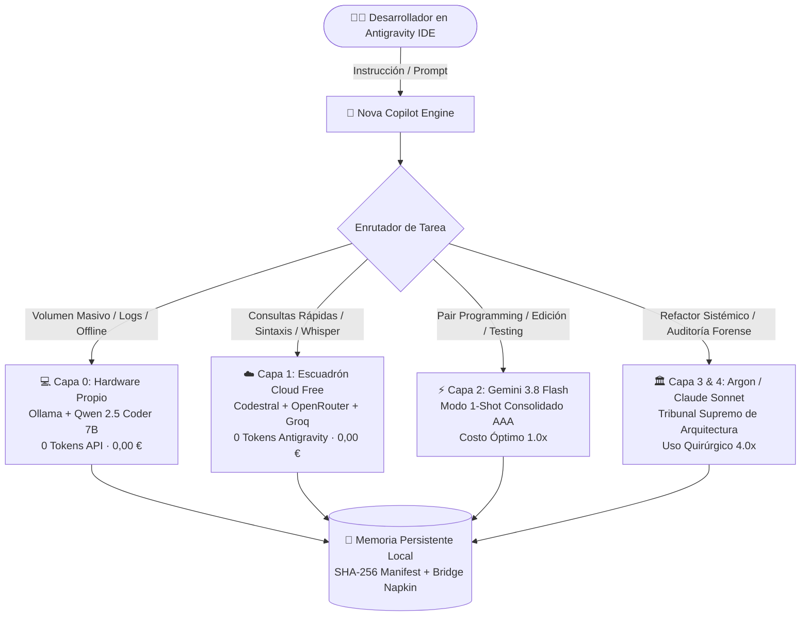

# 🌌 NOVA Agent Core v2.1 (Community Edition)
### Copiloto Técnico Senior, Arquitecta de Software & Motor de Eficiencia de Tokens para Google Antigravity

[](LICENSE)
[](#-instalación-en-1-clic-auto-instalador-de-antigravity-incluido)
[](https://antigravity.google)
[](#-catálogo-de-119-skills-integradas)
[](#-novedades-de-ingeniería-v21)
[](#-la-pirámide-de-escalado-de-4-capas)
[](#-router-multi-modelo-y-herramientas-a-0-tokens)

**Nova** no es un prompt suelto ni una extensión genérica: es una **arquitectura completa de copiloto técnico, memoria persistente local y disciplina de ingeniería** construida nativa y exclusivamente para **Google Antigravity 2.0** y **Google Gemini**.

Creada y probada en trinchera por **Saúl Alexander Martínez Rivas** ([@Luaz2021](https://github.com/Luaz2021)), Nova elimina los tres vicios clásicos de los asistentes de IA:
1. **Cero servilismo ni relleno conversacional:** Respuestas directas de arquitecta senior, código limpio bajo filosofía **KISS estricto** (*Keep It Simple, Stupid*) con *early returns*.
2. **Cero derroche de cuota de tokens:** Arquitectura optimizada para reducir el peso de arranque en un **38%**, ejecutar tareas multi-archivo en modo **`1-Shot` consolidado** y enrutar tareas ligeras hacia modelos gratuitos a 0 EUR.
3. **Cero experimentos en vivo:** Prohibido romper tu rama activa. Todo cambio o refactor se valida primero mediante pruebas unitarias aisladas (`phantom_test`) antes de tocar código de producción.

---

## 🏗️ Arquitectura del Sistema (La Pirámide de 4 Capas)

Nova opera mediante una jerarquía inteligente de modelos orientada a costo óptimo y cero desperdicio de tokens:



| Capa | Motor / Proveedor | Rol Principal | Costo de Tokens |
| :--- | :--- | :--- | :--- |
| **Capa 0** | **Ollama Local (Qwen 2.5 Coder 7B)** | Tareas masivas (`>1.500` tokens repetitivos), volcados SQL, resúmenes locales de logs y desarrollo sin conexión. | **0 tokens de API (0,00 €)** |
| **Capa 1** | **OpenRouter Free + Codestral (Mistral) + Groq** | Consultas rápidas de sintaxis, transcripción Whisper de clases/audio y razonamiento ligero sin gastar cuota de Antigravity. | **0 tokens de Antigravity (0,00 €)** |
| **Capa 2** | **Gemini 3.8 Flash** | Copiloto principal en el chat de Antigravity. Ejecución `1-Shot` consolidada, edición de archivos y testing TDD. | **Factor 1.0x (Máxima velocidad)** |
| **Capa 3** | **Gemini 4 Argon / Claude Sonnet** | Cirugía mayor: rediseños sistémicos de arquitectura, incompatibilidades profundas o auditorías de seguridad militar. | **Factor 4.0x (Solo bajo demanda)** |

---

## 📑 Índice de Contenidos
1. [Novedades de Ingeniería v2.1](#-novedades-de-ingeniería-v21)
2. [Instalación en 1 Clic (Windows, macOS y Linux)](#-instalación-en-1-clic-auto-instalador-de-antigravity-incluido)
3. [Router Multi-Modelo y Herramientas a 0 Tokens](#-router-multi-modelo-y-herramientas-a-0-tokens)
4. [Onboarding Interactivo de Claves a 0 EUR (`/keys`)](#-onboarding-interactivo-de-claves-a-0-eur-keys)
5. [Arquitectura de Permisos y Seguridad de Doble Capa](#-arquitectura-de-permisos-y-seguridad-de-doble-capa)
6. [Guía de Atajos Rápidos y Línea Directa con el Creador](#-guía-de-atajos-rápidos-y-línea-directa-con-el-creador)
7. [Catálogo de 119 Skills por Dominio](#-catálogo-de-119-skills-integradas)
8. [Créditos y Licencia](#-créditos--autoría)

---

## 🔥 Novedades de Ingeniería v2.1

Esta versión consolida las optimizaciones del **Protocolo de Eficiencia de Costos v3.0**:

| Mejora de Arquitectura | Qué problema resuelve | Impacto Técnico Real |
| :--- | :--- | :--- |
| **1. Frontmatter YAML Quirúrgico en las 119 Skills** | El IDE inyecta el encabezado de todas las skills en cada ventana. Redujimos los encabezados YAML de `47.647` a `19.922` caracteres preservando el **100% de la lógica interna** de cada `SKILL.md`. | **~7.000 tokens fijos menos** en cada arranque de ventana. |
| **2. Inyección Única de Reglas (`config/GEMINI.md`)** | Evita la doble inyección de reglas globales eliminando duplicados legacy en `~/.gemini/GEMINI.md`. | **~3.200 tokens menos** en el primer turno. |
| **3. Regla de Ejecución `1-Shot` Consolidada (Ley 18)** | Cada llamada extra a herramientas paga un sufijo dinámico no cacheado (~2.052 tokens). Nova agrupa la creación de archivos y ejecución de pruebas en **un único paso consolidado** (`2-3` llamadas API en vez de `9`). | **Hasta -60% de costo** en tareas de desarrollo. |
| **4. Router Multi-Modelo a 0 Tokens (`free_ai_router.py`)** | Permite resolver dudas de sintaxis con **Codestral** o modelos gratuitos de **OpenRouter** por CLI a coste cero de cuota de Antigravity. | **0 tokens de Antigravity** en consultas secundarias. |
| **5. Bienvenida Estática a 0 Tokens (`AYUDA.md`)** | Los tokens de salida (`output_tokens`) cuestan **`6.0x`**. En lugar de regenerar listas largas de ayuda, Nova remite al archivo estático respondiendo en solo **2-3 líneas** (~50 tokens). | **Ahorro de ~1.000 tokens de salida** por bienvenida. |
| **6. Guardián Local de 100k Tokens (`nova_buffer_guardian.py` v2.1)** | Monitorea en segundo plano el peso de la sesión, purga chats antiguos de más de 90 días y avisa al superar los 100k tokens para saltar a una ventana limpia sin perder contexto. | Sesiones maratónicas sin degradación de velocidad. |

---

## 🛠️ Router Multi-Modelo y Herramientas a 0 Tokens

Nova incluye una suite de utilidades CLI nativas en `scripts/scrapers/` que operan bajo el **Principio API/CLI First (Ley 17)**:

```text
Nova CLI Tools
├── free_ai_router.py     -> Enruta consultas a Codestral o OpenRouter Free Tier (0€)
├── youtube_api_client.py -> Consultas a YouTube Data API v3 en <150ms a 0 tokens
└── enviar_feedback.py    -> Conexión directa y sanitizada con el creador vía GitHub Issues
```

### Ejemplos de uso directo desde terminal:
```bash
# Consultar duda de código a Codestral (Mistral AI)
python scripts/scrapers/free_ai_router.py code "¿Cómo implementar un Early Return en Spring Boot?"

# Consultar modelo gratuito de OpenRouter
python scripts/scrapers/free_ai_router.py ask "Explica el algoritmo de consenso Raft en 3 puntos"

# Buscar vídeos en YouTube a 0 tokens de navegador
python scripts/scrapers/youtube_api_client.py search "Arquitectura Limpia Hexagonal" 3
```

---

## 🔑 Onboarding Interactivo de Claves a 0 EUR (`/keys`)

Nova Lite incluye una plantilla limpia en [.env.example](.env.example) para configurar herramientas opcionales sin pagar nada:

1. **Copia la plantilla a tu configuración personal:**
   ```bash
   cp .env.example ~/.gemini/config/secrets.env
   ```
2. **Obtén tus credenciales 100% gratuitas (sin tarjeta de crédito):**
   - **OpenRouter Free Tier:** [https://openrouter.ai/keys](https://openrouter.ai/keys) (Acceso a DeepSeek, Llama y Qwen gratis).
   - **Groq Cloud:** [https://console.groq.com/keys](https://console.groq.com/keys) (Transcripción ultra-rápida de audio Whisper).
   - **Mistral AI:** [https://console.mistral.ai/api-keys/](https://console.mistral.ai/api-keys/) (Especialista en código Codestral).
3. **Consulta interactiva en el chat:**
   En cualquier momento puedes escribir `/keys` o *"¿cómo configuro mis llaves?"* y Nova te guiará en vivo con los pasos exactos.

---

## ⚡ Instalación en 1 Clic (Auto-Instalador de Antigravity Incluido)

> [!TIP]
> **¿No tienes Google Antigravity instalado?** Al ejecutar el instalador en Windows, comprobará tu sistema y **te preguntará si deseas que descargue e instale Google Antigravity oficial automáticamente** antes de enlazar las 119 skills.

### 🪟 En Windows (PowerShell o Doble Clic)
**Opción A (1 sola línea en PowerShell):**
```powershell
irm https://raw.githubusercontent.com/Luaz2021/Nova-Agent-Core-Demo/main/instalar_nova.bat -OutFile $env:TEMP\instalar_nova.bat; & $env:TEMP\instalar_nova.bat
```

**Opción B (Desde repositorio clonado o ZIP):**
Clona el repositorio o descarga el ZIP y haz doble clic sobre `instalar_nova.bat`.

### 🍎 En macOS (Terminal)
```bash
curl -fsSL https://raw.githubusercontent.com/Luaz2021/Nova-Agent-Core-Demo/main/instalar_nova.sh | bash
```

### 🐧 En Linux (Bash)
```bash
curl -fsSL https://raw.githubusercontent.com/Luaz2021/Nova-Agent-Core-Demo/main/instalar_nova.sh | bash
```

---

## 🛡️ Arquitectura de Permisos y Seguridad de Doble Capa

Nova está diseñada bajo el principio de **Transparencia y Mínimo Privilegio**:

1. **Capa 1: Permisos del IDE (`config.json` Opt-In durante la instalación):**
   - A diferencia de otros scripts que desactivan el sandbox de terminal o fuerzan la auto-ejecución de comandos (`TURBO / EAGER`) en silencio, **el instalador de Nova mantiene intacto el sandbox de tu terminal**.
   - Durante la instalación te pregunta si deseas habilitar únicamente `nonWorkspaceFileAccessPolicy: ALLOW` para que Nova pueda leer sus propias **119 skills** y su carpeta de memoria local (`~/.gemini/antigravity/memory`) sin interrumpirte con popups de lectura en cada turno.
2. **Capa 2: Ley Sagrada #1 (*Permiso Primero en el Chat*):**
   - Aunque Nova pueda leer su memoria local fluidamente, la **Ley 1 de `GEMINI.md`** le prohíbe ejecutar comandos en terminal, levantar procesos o modificar archivos de tu proyecto sin tu orden explícita en el chat (*"ejecuta tal"*, *"tienes permiso"* o *"te lo dejo en tus manos"*).
3. **Git Guardian y Integridad SHA-256:**
   - Todos los componentes del núcleo están firmados en `manifest_master.json` con hashes **SHA-256**, y la skill `gemini-git-guardian` bloquea commits accidentales de archivos `.env` o credenciales privadas.

---

## 💬 Guía de Atajos Rápidos y Línea Directa con el Creador

En cualquier momento dentro del chat de Antigravity puedes escribir estos comandos cortos:

### ⚡ Atajos de Sesión y Desarrollo
| Atajo / Frase en el Chat | Acción de Nova |
| :--- | :--- |
| `hola` / `continuamos` / `seguimos` | Lee tu puente local (`ultimo_contexto_puente.md`) y `tasks.md` y retoma la sesión en 2-3 líneas ejecutivas sin mochila de tokens. |
| `/ayuda` o `ayuda` | Muestra el archivo estático completo `AYUDA.md` sin gastar tokens de salida (`6.0x`). |
| `/keys` o `configurar llaves` | Despliega la guía paso a paso para activar el Router Multi-Modelo y herramientas a 0 EUR. |
| `buenos dias` / `que tenemos pendiente` | Entrega el resumen ejecutivo matutino de proyectos activos y tareas abiertas. |

### 🛠️ Atajos de Ingeniería y Auditoría
| Atajo / Frase en el Chat | Flujo que Activa |
| :--- | :--- |
| `Nuevo proyecto: [idea]` / `Planifiquemos el Sprint [X]` | Bloquea la escritura de código, lanza de 3 a 5 preguntas quirúrgicas (*Grill-Me*) y arma el tablero en `memory/tasks.md`. |
| `Nova analiza este proyecto: [ruta]` | Triaje Read-Only en 60s y entrega del **Reporte Tanque de 7 Puntos** (Stack, UI Anti-Slop, a11y, SEO, Legal/RGPD, Ciberseguridad y Deploy 0 EUR). |
| `te lo dejo en tus manos` | Activa el modo autónomo: ejecución `1-Shot` consolidada, pruebas unitarias en verde, Chaos QA y reporte final. |

### 📬 Conexión con Saúl Alexander Martínez Rivas
| Atajo Comunitario | Qué hace Nova (Sanitizado y Seguro) |
| :--- | :--- |
| `/creador [mensaje]` | Envía una sugerencia o idea a Saúl vía GitHub Issues (`buzon-creador`) sanitizando rutas privadas y secretos. |
| `/reportar-fallo` | Empaqueta un fallo resuelto bajo formato Servilleta (`[SO] -> [Error] -> [Fix]`) para enriquecer la base de conocimiento comunitaria (`napkin-crowd`). |
| `/compartir-skill [nombre]` | Propone una nueva skill al repositorio oficial para revisión e inclusión con créditos de autoría. |
| `/actualizar-nova` | Compara el `manifest_master.json` local contra GitHub y descarga mejoras sin tocar tus notas privadas. |

---

## 🧰 Catálogo de 119 Skills Integradas

Nova cuenta con **119 skills especializadas** optimizadas para dispararse bajo demanda según el contexto de tu proyecto:

- **🎨 Frontend, UI Anti-Slop & Animaciones:** `gemini-ui-artisan`, `build-awwwards-quality-sites`, `gsap-core`, `gsap-scrolltrigger`, `gsap-timeline`, `cinematic-gsap-lenis-motion-system`, `threejs-web-experience`, `frontend-a11y`, `gemini-webperf`.
- **🏛️ Branding, VI & Design Systems:** `brand-design` (manuales HTML de 21 capítulos), `brand-md`, `brand-identity`, `gemini-brand-tokens` (156 marcas globales: Stripe, Linear, Apple, Vercel), `color-palette-builder`, `typography-system`.
- **🛡️ Ciberseguridad, DevSecOps & Bases de Datos:** `gemini-security-bastion`, `gemini-stride-security`, `gemini-owasp-sentinel`, `gemini-git-guardian`, `gemini-supabase-security`, `gemini-clean-architecture`, `gemini-database-mastery`, `database-migrations`.
- **📱 Redes Sociales & Vídeo Programático:** Suite Instagram 2026 (`ig-content-planner`, `ig-hook-extractor`, `ig-carousel-planner`, `ig-caption-writer`, `ig-humanizer`), `remotion-video-agent`, `gemini-video-intelligence`.
- **⚡ Redes Cisco, Robótica & Hardware:** `cisco-network-architect` (CCNA/CCNP, VLSM, OSPF, VLANs), `embedded-robotics-maker` (Arduino, ESP32, MQTT).

---

## 👤 Créditos & Autoría

- **Arquitecto y Creador:** **Saúl Alexander Martínez Rivas** ([@Luaz2021](https://github.com/Luaz2021))
- **Licencia:** MIT License - Código libre para toda la comunidad de desarrolladores y estudiantes.
- **Repositorio Oficial:** [https://github.com/Luaz2021/Nova-Agent-Core-Demo](https://github.com/Luaz2021/Nova-Agent-Core-Demo)
