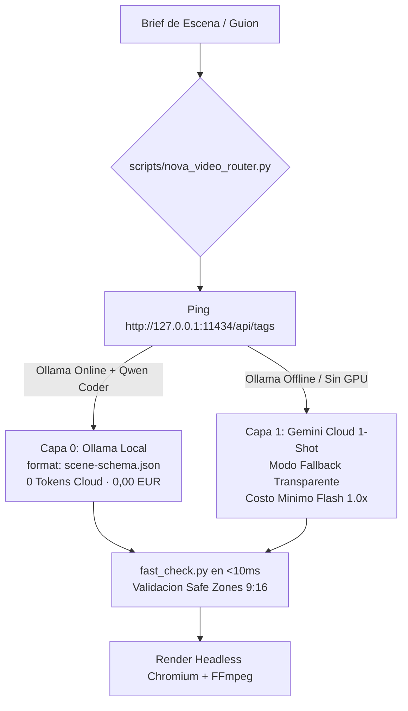

# HyperFrames Director v2.0: Motor de Video Programatico Dual

Genera videos verticales de alta retencion (Instagram Reels, TikTok, YouTube Shorts y demos de producto) mediante estandares web puros y arquitectura agéntica de bajo coste:
1. **Motor A (3D Procedural Studio):** WebGL en Three.js con camara vertical calibrada (9:16), dos personajes 3D procedurales (Dev Humano y Robot Nova) con lip-sync neuronal a 30 Hz y pizarra inteligente con texturas dinamicas.
2. **Motor B (Editorial / B-Roll / Montaje Mixto):** Escenarios de ritmo rapido con fotos reales (producto, gastronomia, lifestyle), fondos generados por IA web y animaciones fluidas a pelo en DOM con GSAP timelines.

Ambos motores operan bajo el **Enrutador Hibrido de IA (`scripts/nova_video_router.py`)**, que detecta automaticamente si el equipo tiene hardware para IA local (Ollama) para operar a **0 tokens de API cloud (-84% de coste)** o si debe activar el **Fallback transparente a Gemini Cloud 1-Shot** para usuarios en laptops basicas sin GPU.

---

## 1. La Distincion de Motores: ¿Cual Usar en Cada Caso?

| Dimension | Motor A: 3D Procedural Studio | Motor B: Editorial / B-Roll / Mixto |
| :--- | :--- | :--- |
| **Tecnologia** | Three.js WebGL + Canvas 2D Texture + Shaders | HTML5 + CSS3 (Transforms GPU) + GSAP Core |
| **Caso de Uso Ideal** | Podcasts tecnicos, debates de arquitectura, tutoriales de producto, explicaciones de codigo y demos agénticas. | Demos comerciales, casos reales (ej. fotos de corte de jamon, ecommerce, gastronomia, unboxings) y lifestyle. |
| **Activos Visuales** | 100% codigo puro procedural (geometria 3D, cubos, cilindros, luces suaves). Cero dependencias de imagenes externas. | Recursos fotograficos reales + recortes de producto + fondos de apoyo de IA generativa web. |
| **Consumo Cloud** | **0 tokens cloud** con Ollama (`scene-schema.json` + GBNF) o 1 llamada minima en Cloud 1-Shot. | 1 llamada para guion y timestamps de audio; animacion orquestada en CSS/GSAP. |
| **Sincronizacion** | Lip-sync facial a 30 Hz (amplitud RMS de audio) sincronizado con rotacion de cabezas y parpadeos. | Keyframes de texto sincronizados palabra por palabra con la voz de locucion real (Audio-First). |

---

## 2. Los 6 Dogmas del Motor HyperFrames

1. **Principio Audio-First (El Audio Dicta el Tiempo):**
   - Prohibido asumir duraciones de animacion a ojo.
   - La locucion se genera primero y se extraen marcas de tiempo por palabra (*word-level timestamps*).
   - Cada escena visual adapta sus keyframes y duracion exacta a la duracion real de la voz.

2. **Mascara de Safe Zones Estricta (9:16 Vertical - 1080x1920):**
   - **Margen Superior Seguro:** Minimo `240px` libres en 3D (`108px` en 2D) para evitar indicadores de interfaz.
   - **Margen Inferior Seguro:** Minimo `340px` libres para respetar botones de cuenta, descripcion y audio de Instagram/TikTok.
   - **Margen Lateral Derecho:** Minimo `110px` libres para zona de interaccion (like, comentar, compartir).
   - **Margen Lateral Izquierdo:** Minimo `40px` libres.
   - La pizarra 3D y subtitulos jamas invaden estas areas de corte.

3. **Calibracion de Camara 3D en 9:16:**
   - En Three.js, `PerspectiveCamera(fov, aspect)` usa FOV vertical. En formato vertical (aspect = 0.5625), un FOV estandar de 42° reduce el angulo horizontal a 24.4°, recortando los lados.
   - Calibracion obligatoria: `vFOV = 50°`, `camZ = 6.85`, elevacion `camY = 1.62`. Permite encuadrar a ambos personajes (`x = -0.74` y `x = +0.74`) y la pizarra 3D con margenes laterales generosos.

4. **Subtitulos 100% en el DOM (Cero Filtro Subtitles en FFmpeg):**
   - Los subtitulos dinamicos (karaoke palabra a palabra) se renderizan como elementos HTML con CSS (`transform`, `opacity`, `text-shadow`) o sobre canvas.
   - Elimina incompatibilidades de fuentes y fallos de sintaxis en FFmpeg.

5. **GSAP y Canvas como Motores de Tiempo Discreto:**
   - La captura de frames no usa tiempo real (`Date.now()` o `requestAnimationFrame`), sino saltos deterministas: `window.__novaStudio.frameAt(t)` con `t = frameIndex / fps`.
   - Garantiza que cualquier maquina exporte exactamente el mismo video fluido a 30 FPS sin tirones.

6. **Masterizado Final FFmpeg a CRF 18 con Normalizacion EBU R128:**
   - Compresion en espacio de color `bt709`, formato de pixel `yuv420p` y audio masterizado a `-14 LUFS` (estandar de TikTok e Instagram).

---

## 3. Enrutador Hibrido: Capa 0 (Ollama Local) vs Capa 1 (Cloud Fallback)

El script `scripts/nova_video_router.py` resuelve de forma automatica el dilema de hardware:



### Comandos de Diagnostico y Generacion:

```bash
# 1. Comprobar si el equipo tiene IA local disponible o requiere fallback:
python scripts/nova_video_router.py --check

# 2. Generar escena en modo automatico (Usa Ollama si existe; si no, fallback a Cloud):
python scripts/nova_video_router.py --prompt "Mito vs Realidad de Nova Core" --out escena1.json

# 3. Forzar modo local exclusivamente:
python scripts/nova_video_router.py --prompt "Arquitectura Limpia" --mode local

# 4. Forzar modo Cloud 1-Shot:
python scripts/nova_video_router.py --prompt "Arquitectura Limpia" --mode cloud
```

---

## 4. Contrato de Prompt en 3 Capas (Ahorro de Tokens)

Para evitar inflar el contexto al usar IA local o cloud, el sistema desacopla la generacion en 3 capas:

1. **Capa Fija (Inmutable en Modelfile / System Prompt):**
   - Reglas inmutables del DSL.
   - Nombres de widgets permitidos: `comparison_card`, `device_morph`, `timeline_tracks`, `node_network`, `github_search`.
   - Coordenadas normalizadas `[0.125, 0.792]` para Safe Zones.
2. **Capa Semi-Fija (`scene-schema.json`):**
   - Esquema JSON con union discriminada en el campo `theme` (`neon_noir`, `warm_organic`, `blueprint`, `clean_tech`).
   - Forzado de longitud maxima en titulares (`maxLength: 42`) para evitar solapamientos.
3. **Capa Variable (User Prompt Minimo):**
   - Unicamente el brief especifico de la escena (ej. `"Scene 1: mito de chatbots frente a agentes de ingenieria"`).

---

## 5. Estructura de Plantillas del Estudio 3D (`templates/3d_studio/`)

Los archivos base probados y calibrados se encuentran en:
`skills/hyperframes-director/templates/3d_studio/`

- `storyboard_schema.py`: Generador en Python estandar (sin dependencias externas) del esquema formal `scene-schema.json`.
- `scene-schema.json`: Esquema JSON estricto con union discriminada por tema.
- `fast_check.py`: Validador sub-10ms que comprueba conformidad de esquema, lista blanca de componentes y limites de Safe Zone en 9:16.
- `Modelfile`: Definicion para empaquetar el modelo local `nova-dsl` en Ollama con system prompt y few-shots.
- `runtime_studio.js`: Motor 3D Three.js desacoplado con camara calibrada, personajes Dev y Nova, pupitre y canvas dinámico proyectado.
- `stage_template.html`: Escenario HTML con canvas WebGL y capa de subtitulos karaoke estilo neo-brutalista.
- `render_mp4.py`: Script de captura con Chromium Headless WebGL transmitiendo directamente a FFmpeg por tuberias (pipes) a 30 FPS.

---

## 6. Checklist de QA Pre-Render

1. [ ] ¿Se ejecuto `python scripts/nova_video_router.py --check` para verificar el motor de ejecucion?
2. [ ] ¿Las escenas cumplen con la validacion de `fast_check.py` antes de renderizar?
3. [ ] ¿La locucion neural fue generada primero y los timestamps alimentan la timeline de subtitulos?
4. [ ] ¿Los personajes y la pizarra 3D estan contenidos entre Y=240px y Y=1520px?
5. [ ] ¿El render final utiliza CRF 18 con espacio de color `bt709` y audio normalizado a -14 LUFS?
